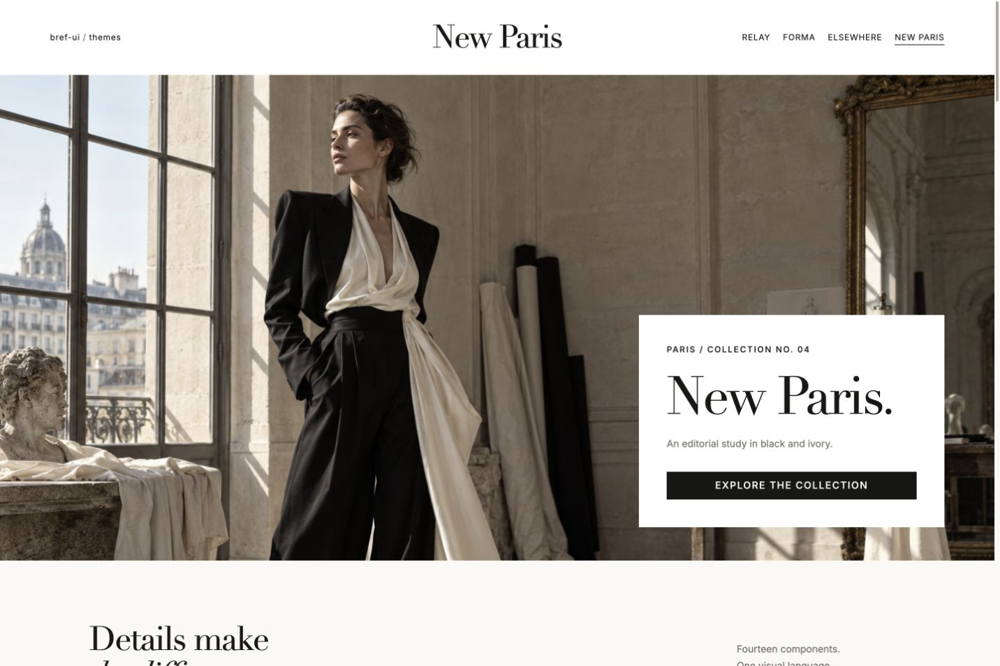

# Bref-ui themes

Working Svelte demos built with [bref-ui](https://github.com/feuersteiner/bref-ui),
plus a workspace for full CLI-installed component themes.

[Explore the showcase](https://feuersteiner.github.io/bref-ui-themes/) ·
[Bref-ui documentation](https://feuersteiner.github.io/bref-ui/)

## Site palettes

Todo, House Shop and RunnerAI import their controls directly from `bref-ui`.
Relay, Forma and Elsewhere are palette names, not separate component libraries.
Their palette data lives in [src/routes/palettes.ts](src/routes/palettes.ts).

| Palette   | Site demo                                                              | Palette preview                                                             |
| --------- | ---------------------------------------------------------------------- | --------------------------------------------------------------------------- |
| Relay     | [Todo](https://feuersteiner.github.io/bref-ui-themes/todo)             | [Relay](https://feuersteiner.github.io/bref-ui-themes/themes/relay)         |
| Forma     | [House Shop](https://feuersteiner.github.io/bref-ui-themes/house-shop) | [Forma](https://feuersteiner.github.io/bref-ui-themes/themes/forma)         |
| Elsewhere | [RunnerAI](https://feuersteiner.github.io/bref-ui-themes/runner-ai)    | [Elsewhere](https://feuersteiner.github.io/bref-ui-themes/themes/elsewhere) |

Todo includes projects, filters, task completion and editing. House Shop includes
product filtering, dialogs, cart quantities and simulated checkout. RunnerAI assesses
sample marketing copy through Setup, Run and Results, with workflow nodes, an
inspector and edits to a local draft. No external AI service is used.

Use the supported Bref palette API in an application:

```svelte
<script lang="ts">
	import { Theme, Button } from 'bref-ui';
</script>

<Theme palette={{ primary: '#375b86', background: '#f3f6fa' }}>
	<Button label="Create project" variant="filled" color="primary" />
</Theme>
```

The showcase keeps one `Theme` and the shared header mounted, changing the palette
with the active route. `bref-ui@2.2.3` writes document-wide palette tokens; multiple
independent palettes cannot be isolated with its public API. The shell's library
controls therefore use the active document palette. No demo-owned root tokens or
component style overrides are used. Layout and application content remain local.

## Package boundary

The former `bref-ui-themes/relay`, `/forma` and `/elsewhere` entries, and the root
`Relay`, `Forma` and `Elsewhere` namespaces, have been removed. Import controls and
`Theme` from `bref-ui` instead, and pass palette data to `Theme`.

New Paris is available through `bref-ui-themes/new-paris` and the root `NewParis`
namespace. Full themes own CLI-installed component implementations with scoped
CSS; the site demos do not. Glassy, VS Code and Crystal Code remain in separate PRs.

## New Paris

[Open the New Paris showcase](https://feuersteiner.github.io/bref-ui-themes/themes/new-paris).
The theme retains its black/ivory palette, square controls, serif headings and
opaque paper overlays. Its showcase imports the same implementation as consumers.
Campaign photography and editorial layout belong to the showcase.



```svelte
<script lang="ts">
	import { Theme, Button } from 'bref-ui-themes/new-paris';
</script>

<Theme>
	<Button label="Bonjour" variant="filled" color="primary" />
</Theme>
```

The entry exports `Theme`, `ThemeModeToggle`, `Button`, `Checkbox`, `Combobox`,
`Dialog`, `Icon`, `Pill`, `PillChoiceGroup`, `PillGroup`, `Popover`, `Progress`,
`Select`, `Spinner`, `Surface`, `Switch`, `Tabs`, `TextArea`, `TextInput` and `TreeView`.
The inherited CLI implementation preserves Bref props, bindings and keyboard
behavior. The registry has no ThemeModeToggle entry; its native source is retained
explicitly. New Paris uses fixed light mode and scoped tokens/paint; the separate
site palettes still use Bref's document-wide public palette API.

Native accessibility, reduced-motion and forced-colors styles are retained.
The approved paper/border colors have a low-contrast boundary (about 1.46:1);
contrast improvement remains a design decision. No human visual approval is claimed.

## Development and checks

Use Bun 1.3.4+ and Node 24:

```sh
bun install --frozen-lockfile
bun run dev
bun run check
bun run lint
bun run build
npm pack --ignore-scripts
```

`build` produces the static showcase in `build` and the package in `dist`, including
publint validation. No test script is defined. Source uses `bref-ui@^2.2.3`.

The Pages workflow deploys on pushes to `main`. To verify its base path locally:

```sh
BASE_PATH=/bref-ui-themes bun run build:site
BASE_PATH=/bref-ui-themes bun run preview
```

## Source

- [Site demos](<src/routes/(sites)>): application content and local layout.
- [Palette previews](<src/routes/(themes)>): canonical Bref controls with each palette.
- [Persistent shell](src/routes/+layout.svelte): one Theme, route palettes and mounted header.
- [New Paris sources](src/lib/new-paris): full theme, native controls and scoped styles.
- [Package root](src/lib/index.ts): full-theme namespaces.

## Contributing

See [CONTRIBUTING.md](CONTRIBUTING.md). Base components, their API and the CLI are
maintained in [bref-ui](https://github.com/feuersteiner/bref-ui).

Report issues through [GitHub Issues](https://github.com/feuersteiner/bref-ui-themes/issues)
or join [Discord](https://discord.gg/JpgQRTUsVS) and use the `bref-ui` channel.

[MIT](LICENSE).
