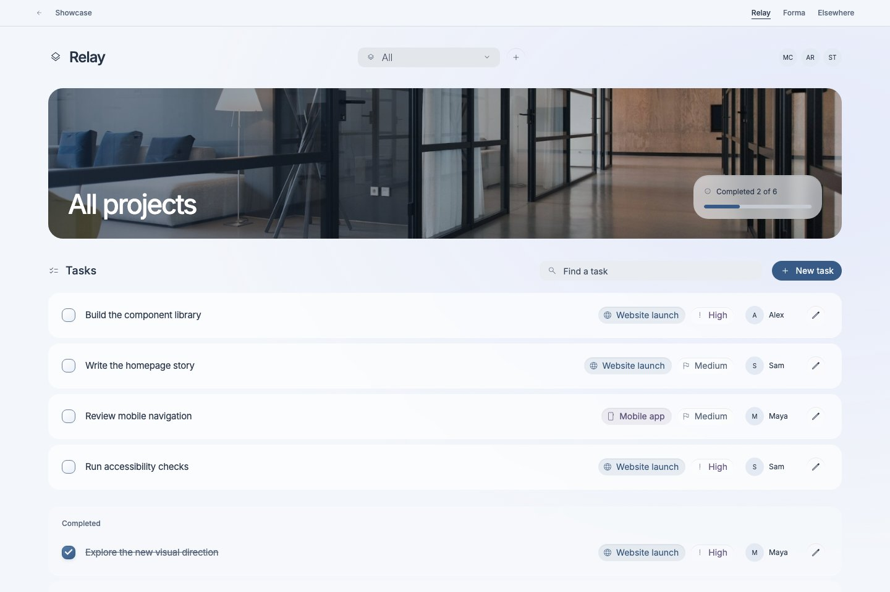
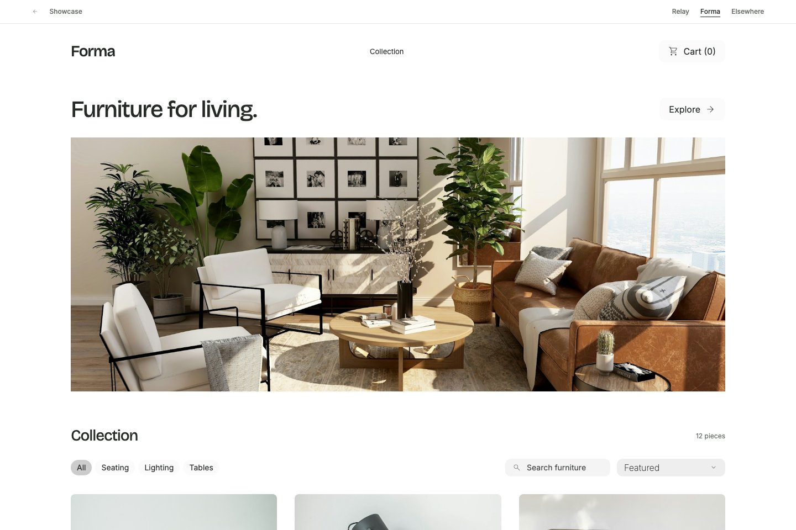
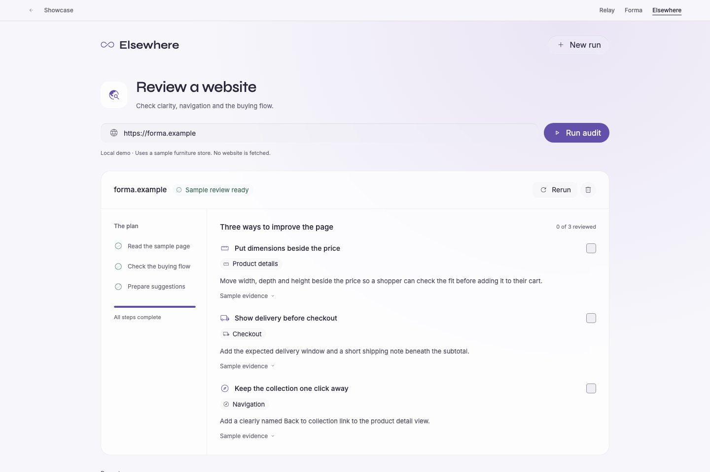

# bref-ui-themes

Reusable Svelte 5 themes for [bref-ui](https://github.com/feuersteiner/bref-ui), with interactive demos and native CSS. The package is an unpublished review candidate built on SvelteKit 3.

[Explore the showcase](https://feuersteiner.github.io/bref-ui-themes/) · [Bref documentation](https://feuersteiner.github.io/bref-ui/) · [Join Discord](https://discord.gg/JpgQRTUsVS)

## Local development

Requires Bun 1.3.4 or newer. The scaffold uses Svelte 5, SvelteKit 3, Vite 8 and `svelte-package` 3.

```sh
bun install
bun run dev                     # http://localhost:5173
bun run check
bun run lint
bun run package                 # library → dist; includes publint
bun run build:site              # static showcase → build
bun run build                   # site + library
bun run preview                 # preview the production site
bun pm pack                     # creates a local npm tarball; does not publish
```

The restored GitHub Pages workflow builds `build:site` on pushes to `main`, using the Pages base path and uploading `build`. To reproduce the project-path build locally:

```sh
BASE_PATH=/bref-ui-themes bun run build:site
BASE_PATH=/bref-ui-themes bun run preview # http://localhost:4173/bref-ui-themes/
```

## Showcase and demo sites

Open the [showcase](http://localhost:5173/). The showcase uses base `bref-ui` Theme, Button, Surface, Pill and Icon components, default palette/styles, documentation fonts and the Bref logo. Each card uses an actual browser screenshot and links to the working site. Every demo provides a Showcase link; navigation between themes reloads the document to avoid retaining global CSS.

| Demo          | Implemented interactions                                                                 | Site                                          | Theme demonstration                                         |
| ------------- | ---------------------------------------------------------------------------------------- | --------------------------------------------- | ----------------------------------------------------------- |
| Tasks         | Project creation/filtering, task search, completion and task editing                     | [/relay](http://localhost:5173/relay)         | [/themes/relay](http://localhost:5173/themes/relay)         |
| House Shop    | Furniture filtering/sorting, product dialogs, cart quantities and simulated checkout     | [/forma](http://localhost:5173/forma)         | [/themes/forma](http://localhost:5173/themes/forma)         |
| Site Reviewer | URL validation, simulated audit progress, stopping/rerunning, history and finding review | [/elsewhere](http://localhost:5173/elsewhere) | [/themes/elsewhere](http://localhost:5173/themes/elsewhere) |





**WIP:** VS Code, Liquid Glass and Minimalist Blocky are planned. They have no exports, demonstration routes or availability links.

## Library imports

Install the local tarball with `bun add ./bref-ui-themes-0.0.1.tgz`. Consumers need Svelte `^5.57.1` and Bref `^2.1.3` (peer dependencies). Fonts used by the themes are package dependencies.

```svelte
<script lang="ts">
	import { Theme, Button } from 'bref-ui-themes/relay';
</script>

<Theme>
	<Button label="Create project" variant="filled" color="primary" />
</Theme>
```

The same API is available from each implemented theme:

```ts
import { Theme, Button } from 'bref-ui-themes/forma';
// Or: import { Theme, Button } from 'bref-ui-themes/elsewhere';
// Namespace exports: import { Relay, Forma, Elsewhere } from 'bref-ui-themes';
```

Each entry exports `Theme`, `Button`, `Checkbox`, `Dialog`, `Icon`, `Pill`, `PillChoiceGroup`, `PillGroup`, `Popover`, `Progress`, `Select`, `Spinner`, `Surface` and `TextInput`. `Theme` takes an optional `children` snippet. Controls retain Bref's props, native attributes and applicable bindings; their types remain imported from `bref-ui/types`.

These initial themes provide the demo palettes, fonts, common CSS and component styling. They use light mode and document-global Bref tokens/reset styles; mount one theme per document and use full-page navigation when changing themes. Site-specific layouts and content are separate from the library.

## Source layout

- `src/lib/<theme>/index.ts`: public theme entry; each site's demo and theme demonstration consume it.
- `src/lib/components`: Bref CLI-copied controls and their local dependencies, with `bref-ui/types` imports preserved.
- `src/lib/shared`: common reusable theme styling.
- `src/routes/(sites)`: complete Tasks, House Shop and Site Reviewer sites and the latest shared demo shell.
- `src/routes/(themes)`: demonstrations of implemented public theme exports.
- `src/routes/catalog`: showcase content adapted from the reusable gallery.
- `static/demos`: original photographic assets; `static/previews`: rendered catalog previews. Neither is included in the npm package.

The migration preserves the local checkbox motion/reduced-motion fix and animated dialog title/icon updates. Only demo-owned files were extracted from their source branches; the latest Relay shared shell was kept. See [verification.md](verification.md) for source revisions, validation and remaining limitations.
